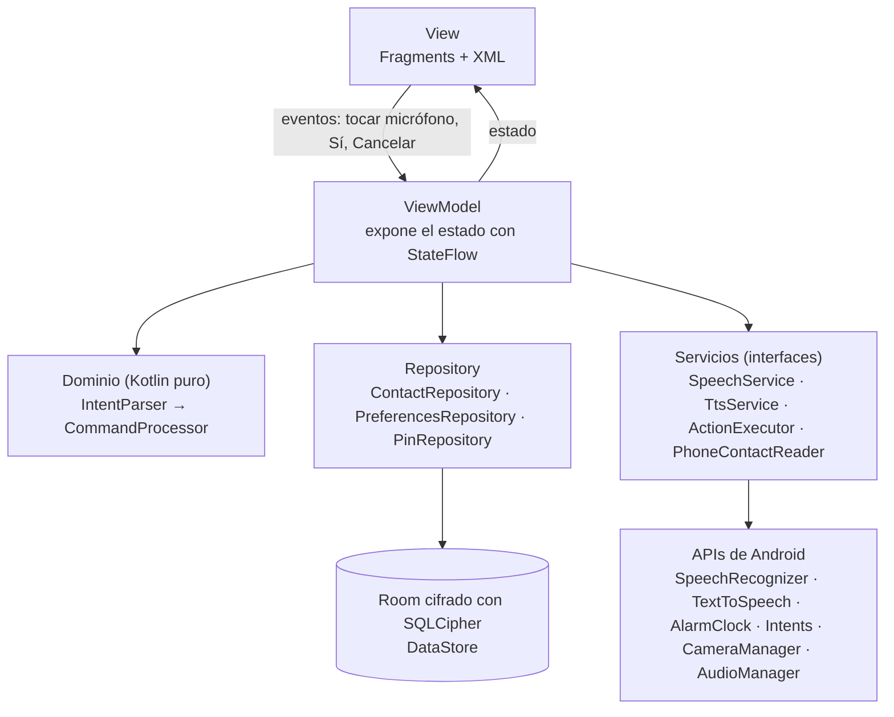

# Withyou

**Una app Android para que las personas mayores usen su teléfono hablándole, en español de Chile.**

Withyou es una capa de accesibilidad por voz: en vez de navegar menús, la persona toca un botón grande y dice lo que necesita. La app entiende la instrucción, **pide confirmación antes de cualquier acción importante** y responde **por voz y en pantalla a la vez**. Si no entiende, nunca falla en silencio: ofrece opciones.

> Proyecto Capstone · Ingeniería en Informática · Duoc UC
> Profesor: Aldo Martínez · Metodología: Cascada · Fase 2 (Desarrollo) completa · Fase 3 (Cierre) en curso

---

## Qué hace

| Le dices… | La app… |
|---|---|
| "¿Qué hora es?" · "¿Qué día es hoy?" | Responde la hora o la fecha |
| "Enciende la linterna" · "Sube el volumen" | Lo hace de inmediato |
| "Pon una alarma para mañana a las ocho" | Pide confirmación y la crea en el Reloj del teléfono |
| "Recuérdame tomar la pastilla a las nueve" | Crea una alarma con el nombre "Tomar la pastilla" |
| "Llama a María" | Busca en tus contactos frecuentes, confirma y llama |
| "Dile a Pedro que llego tarde" | Te lee el mensaje en voz alta, confirma y abre Mensajes con el texto listo |

**Pensado para personas mayores:**

- **Confirmación obligatoria** antes de llamar, enviar mensajes o crear alarmas, con un botón verde "Sí" y uno rojo "Cancelar", o diciendo "sí" o "no".
- **Tolera errores.** Entiende frases coloquiales ("un cuarto para las nueve", "llámame a mi hija"), nombres mal reconocidos y, si algo es ambiguo, pregunta: "¿Quisiste decir…?".
- **Letra y botones grandes:** texto de 18 sp o más, botones de 56 dp o más, y el usuario puede agrandar el texto hasta el 160 %.
- **Diseño responsive:** los botones principales se ven siempre, incluso en pantallas pequeñas, con texto grande o con el teclado abierto.
- **Compatible con TalkBack.**

**Para el cuidador:**

- **Contactos frecuentes:** se agregan a mano o desde la agenda del teléfono.
- **PIN** para proteger los Ajustes y los cambios en Contactos. Llamar y hablar con la app siguen sin PIN.
- **Ajustes de accesibilidad:** tamaño del texto, volumen de la voz y respuesta por voz.

## Requisitos

- Android **8.0 o superior** (minSdk 26).
- **Internet:** en teléfonos Android Go el reconocimiento de voz no funciona sin conexión.
- **"Servicios de voz de Google"** activado, para que la app pueda hablar.

Se probó en un **Samsung Galaxy J2 Core** (Android 8.1 Go, 1 GB de RAM), el tipo de teléfono que tiene el usuario objetivo, y en un **Samsung Galaxy S25 FE**. Como cada teléfono trae reconocedores de voz distintos, si uno falla la app prueba los demás instalados antes de mostrar un error.

## Resultados

| Indicador | Resultado |
|---|---|
| Requerimientos funcionales | 13 de 13 |
| Requerimientos no funcionales | 8 de 8 |
| Casos de uso | 8 de 8 operativos |
| Pruebas automatizadas | 158 unitarias + 18 en el teléfono (8 de interfaz), todas aprobadas |
| Tiempo de respuesta | **424 ms** en promedio desde la última palabra (meta ≤ 3 s) |
| Memoria | 38 MB en un teléfono de 1 GB (4,4 % de la RAM) |

El detalle completo (trazabilidad de requerimientos, pruebas, mediciones, problemas resueltos y decisiones técnicas) está en [`docs/avance-fase2.md`](docs/avance-fase2.md).

## Arquitectura

**MVVM por capas con Repository**, con inyección de dependencias manual (`AppContainer`).



**Reglas de la arquitectura:**

- La View conoce al ViewModel, pero **el ViewModel nunca conoce a la View** ni usa el `Context` de una Activity.
- El **dominio es Kotlin puro**, sin dependencias de Android, así que se prueba con JUnit sin teléfono.
- Las **APIs del teléfono** quedan detrás de interfaces, para reemplazarlas por versiones falsas (*fakes*) en las pruebas.
- **Cómo se entiende una frase:** 1) normalizar el texto; 2) `IntentParser` propone hasta 3 intenciones con su nivel de confianza; 3) `CommandProcessor` decide si ejecutar, confirmar, aclarar, pedir un dato o rechazar.

## Estructura del proyecto

```
app/src/main/java/cl/withyou/app/
├── ui/            Pantallas (View) y ViewModels: home, confirm, clarify, result,
│                  contacts, messages, settings, security, assistant
├── domain/
│   ├── model/     UserIntent, Decision, ParseResult, TimeSpec, Contact…
│   ├── parser/    TextNormalizer, TimeExtractor, ContactMatcher, IntentParser…
│   ├── processor/ CommandProcessor
│   ├── validation/ContactValidator
│   └── security/  PinHasher (PBKDF2)
├── data/
│   ├── local/     AppDatabase (Room + SQLCipher), DatabasePassphrase (Keystore)
│   ├── prefs/     PreferencesRepository, PinRepository (DataStore)
│   └── repository/ContactRepository
├── services/      Voz, texto a voz, acciones del teléfono y agenda
└── di/            AppContainer
```

## Tecnologías

| | |
|---|---|
| Lenguaje | Kotlin 1.9.22 (JDK 17) |
| Interfaz | Android Views + XML, ViewBinding, Material Design 3, Navigation Component |
| Estado | ViewModel, StateFlow, Kotlin Coroutines |
| Voz | `SpeechRecognizer` (es-CL) y `TextToSpeech` |
| Interpretación | `IntentParser` propio, basado en reglas y patrones |
| Base de datos | Local en el teléfono: Room 2.6.1 (SQLite) cifrado con SQLCipher 4.6.1, y Jetpack DataStore para preferencias |
| Cloud | No usa servidor propio ni servicios en la nube. Solo el reconocedor de voz del sistema, que en Android Go necesita internet |
| Pruebas | JUnit 4, kotlinx-coroutines-test, Espresso y espresso-accessibility |
| Compilación | Gradle 8.2.1, Android Gradle Plugin 8.2.2 |
| Versionado | Git y GitHub, una rama por funcionalidad |

## Cómo compilar y ejecutar

1. Clona el repositorio y ábrelo en **Android Studio**.
2. Android Studio crea `local.properties` con la ruta del SDK. Si compilas por consola, créalo con `sdk.dir=<ruta del Android SDK>`.
3. Conecta un teléfono con **depuración USB** activada y presiona **Run**.

Por consola:

```bash
./gradlew assembleDebug
```

El APK queda en `app/build/outputs/apk/debug/app-debug.apk`. En Windows usa `gradlew.bat`. Para instalarlo en el teléfono:

```bash
adb install -r app/build/outputs/apk/debug/app-debug.apk
```

**Docker no aplica:** Withyou es una app Android nativa que corre completa en el teléfono, sin servidor, API ni base de datos externa que contenerizar. El despliegue es instalar el APK. Tampoco usa variables de entorno ni claves de API. La justificación está en el Documento de Diseño (sección 8) y el paso a paso en el Manual Técnico.

## Pruebas

**Pruebas unitarias (JUnit),** sin teléfono:

```bash
./gradlew testDebugUnitTest
```

El reporte queda en `app/build/reports/tests/testDebugUnitTest/index.html`.

**Pruebas en el teléfono:** Room, DataStore, cifrado e interfaz con Espresso y el verificador de accesibilidad de Google. Se ejecutan con `am instrument` porque `connectedAndroidTest` desinstala la app al terminar, y las de interfaz necesitan el teléfono desbloqueado.

```bash
./gradlew assembleDebug assembleDebugAndroidTest
adb install -r app/build/outputs/apk/debug/app-debug.apk
adb install -r app/build/outputs/apk/androidTest/debug/app-debug-androidTest.apk
adb shell am instrument -w cl.withyou.app.test/androidx.test.runner.AndroidJUnitRunner
```

## Seguridad y privacidad

- **Datos cifrados:** los contactos se guardan en una base de datos cifrada con SQLCipher (AES-256). La clave se genera al azar y queda protegida por el **Android Keystore**.
- **PIN protegido:** el PIN del cuidador se guarda como hash **PBKDF2** con sal aleatoria, nunca en texto plano.
- **Permisos mínimos**, siempre explicados antes de pedirlos:
  - Micrófono (`RECORD_AUDIO`): para escuchar las instrucciones.
  - Llamadas (`CALL_PHONE`): opcional. Si se niega, se abre el teléfono con el número marcado.
  - Alarmas (`SET_ALARM`): permiso normal, Android no lo pregunta.
- **Sin permisos para la agenda ni para los SMS.** Agregar desde la agenda no usa `READ_CONTACTS` (Android da acceso solo al contacto elegido) y los mensajes no usan `SEND_SMS`.
- **El audio no se graba ni se guarda**, y no se envían datos a terceros (Ley 19.628).

## Limitaciones conocidas

- En **Android Go** el reconocimiento de voz requiere internet.
- Los mensajes **abren la app de Mensajes con el texto listo**; el usuario toca Enviar. El envío automático quedó como mejora futura.
- Una alarma para "mañana" se programa para la próxima vez que llega esa hora, por cómo funciona el Reloj del sistema.
- Si se olvida el PIN, hay que borrar los datos de la app desde los Ajustes del teléfono.

## Equipo

| Integrante | Rol |
|---|---|
| Miguel Pereira | Jefe de proyecto |
| Baltasar Ordoñez | Voz e interpretación |
| José Luis Donoso | Interfaz y accesibilidad |
| Joaquín Mendoza | Pruebas y documentación técnica |

## Metodología

El proyecto sigue la metodología **Cascada**: cada fase se termina y se valida antes de empezar la siguiente.

| Fase | Contenido | Estado |
|---|---|---|
| Inicio | Problema, objetivos, Acta de Constitución, estado del arte | ✅ Fase 1 |
| Análisis | Requerimientos funcionales y no funcionales, casos de uso, mockup | ✅ Fase 1 |
| Diseño | Arquitectura, modelo de datos, seguridad | ✅ Fase 1 |
| Desarrollo | 8 pasos, MVP primero: núcleo de interpretación → voz → hora, linterna y alarma → contactos y llamadas → mensajes → preferencias → seguridad y accesibilidad | ✅ Fase 2 |
| Pruebas | Unitarias, integración, rendimiento y seguridad (hechas); usabilidad con adultos mayores (semana 14) | 🟡 En curso |
| Cierre | Documentación final y presentación | ⏳ Fase 3 |

Dentro del desarrollo se trabaja con **una rama de Git por paso o funcionalidad**, que se une a `main` solo después de pasar sus pruebas y de probarse en el teléfono.

## Documentación

- [`docs/diagramas/`](docs/diagramas/): diagramas de arquitectura, componentes, casos de uso, clases, secuencia y modelo de datos (fuente Mermaid e imagen).
- [`docs/nota-traspaso.md`](docs/nota-traspaso.md): **empieza aquí si vas a continuar el proyecto** (estado, cómo ponerlo a andar, trampas conocidas y próximos pasos).
- [`docs/avance-fase2.md`](docs/avance-fase2.md): informe completo de la Fase 2.
- [`docs/evidencia-rnf03-latencias.log`](docs/evidencia-rnf03-latencias.log): registro original de la medición del tiempo de respuesta.
- [`CLAUDE.md`](CLAUDE.md): contexto, requerimientos, arquitectura y convenciones del proyecto.
- Documentos formales de la metodología (Requerimientos SRS, Diseño, Plan de Pruebas y Manual Técnico): carpeta `Fase 2/Evidencias Proyecto` del repositorio de entrega.

---

*Proyecto académico desarrollado para el Capstone de Ingeniería en Informática de Duoc UC.*
